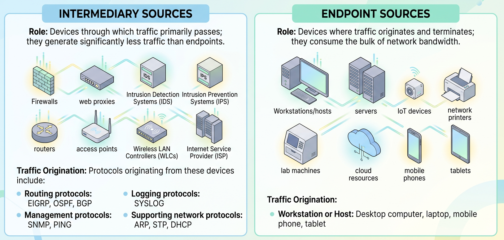
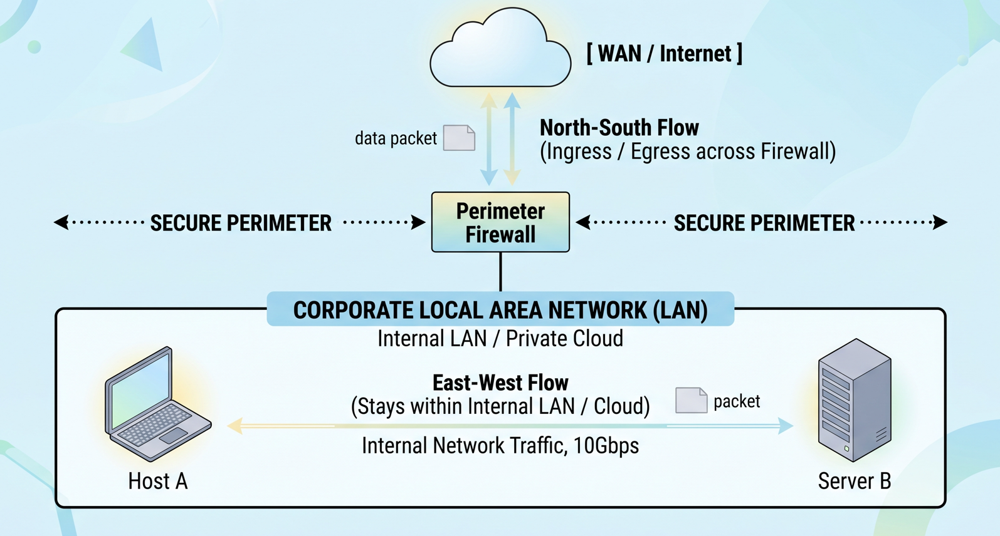
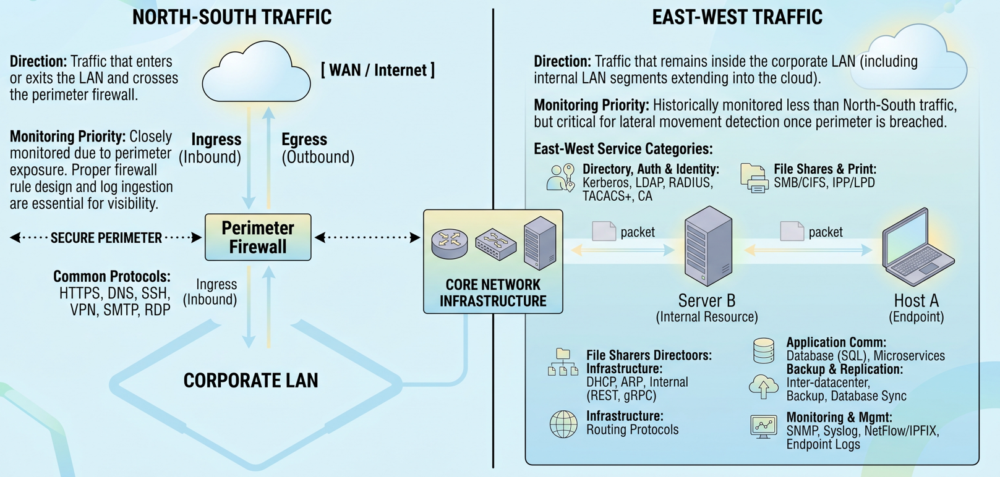
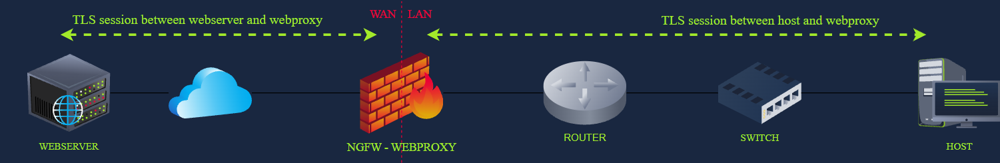
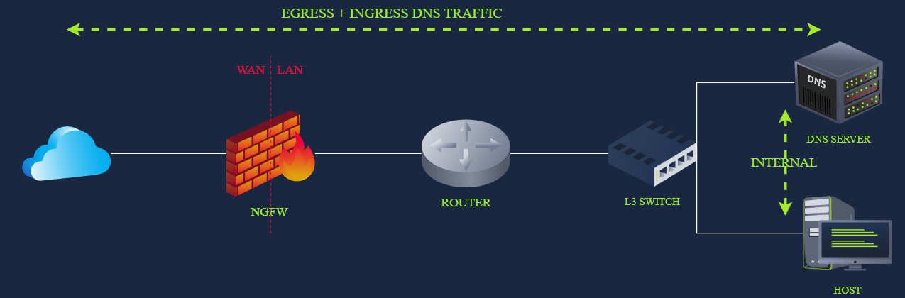
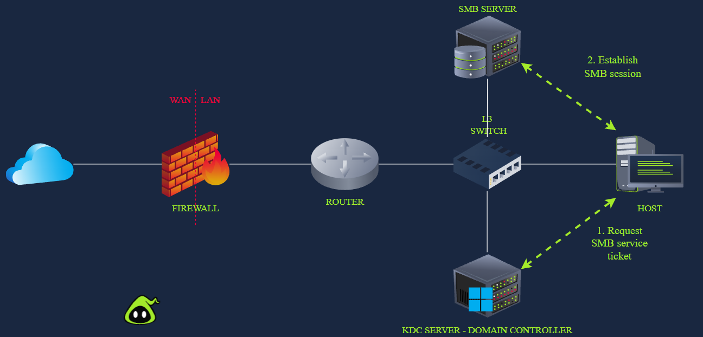

# Network Traffic Analysis Fundamentals

## What network traffic analysis means to me

Network Traffic Analysis is the process of capturing, inspecting, and analyzing data as it moves across a network. The aim is to understand communication between internal systems and external networks.

I treat network traffic analysis as a method, not as the name of one tool. Wireshark is one tool I can use within that method.

My notes group the work into three areas:

- Deep Packet Inspection
- Network flow statistics
- Correlation across multiple log sources

## Why packet-level visibility matters

Firewalls and web proxies commonly record metadata. This can include timestamps, source and destination IP addresses, ports, domains, HTTP request details, and status codes.

These records are useful, but they may not contain the full content of a packet. A packet capture can provide more detail when the traffic and payload were captured.

For example, a proxy log may show that a host requested a ZIP file and received an HTTP 200 response. A suitable packet capture may contain the transferred bytes, which can be reassembled and exported for further review.

## Main uses

My notes identify these uses for network traffic analysis:

- Reviewing network performance, latency, and throughput
- Inspecting suspicious internal and external communication
- Looking for possible lateral movement
- Reviewing DNS activity and possible data exfiltration
- Reconstructing the sequence of network events during incident response
- Validating or dismissing security alerts

## TCP/IP layers and packet inspection

I use the TCP/IP layers to organize the fields I review.

| Layer | Examples from my notes | What I look at |
| --- | --- | --- |
| Application | DNS, HTTP, TLS, SMB | Requests, responses, record types, and available payload |
| Transport | TCP, UDP | Ports, flags, sequence numbers, and acknowledgements |
| Internet | IPv4, IPv6 | Source and destination addresses, TTL, and fragmentation fields |
| Link | Ethernet, ARP | MAC addresses and ARP request or reply behaviour |

## Logs and packet captures

Logs and packet captures answer different questions.

- Logs help establish which event was recorded, when it happened, and which systems were involved.
- Packet captures can show packet headers and captured payload data.
- Correlating both sources can help connect an event in a log with the underlying network exchange.

I do not assume that a PCAP contains every packet or that every payload can be read. The capture scope and encryption affect what I can establish.

## Network sources and flow examples

The following images are the actual reference files from my Network Traffic Analysis notes. They cover network sources, flow information, and example communication paths.

### Network sources

### Network flows

### Traffic flow examples

The examples below cover HTTPS proxy inspection, external DNS resolution, and SMB file share access using Kerberos authentication. I use them to understand the path communication can take and where inspection may occur.

These are reference diagrams from my notes. They are not packet-level findings from a separate investigation.
