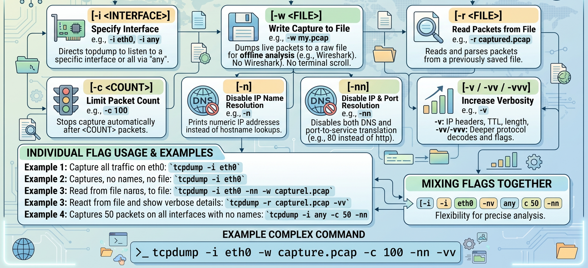
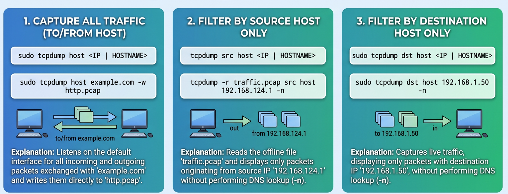
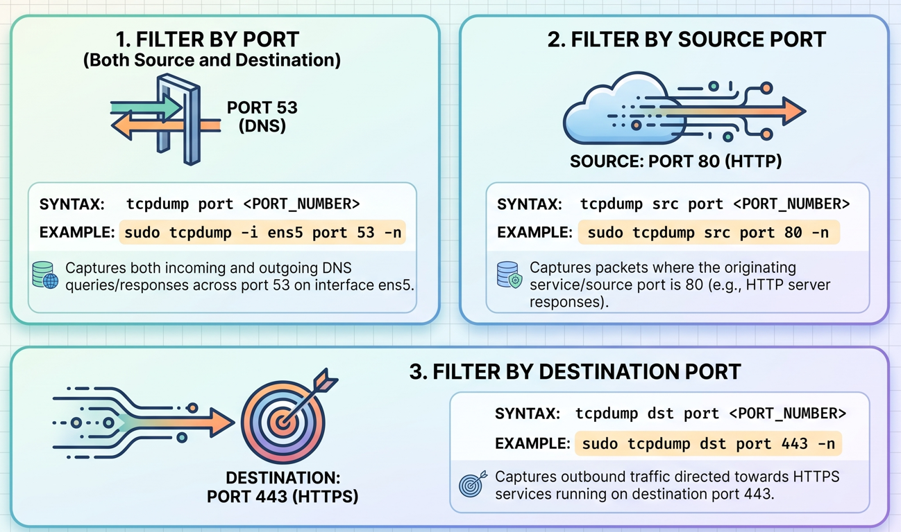
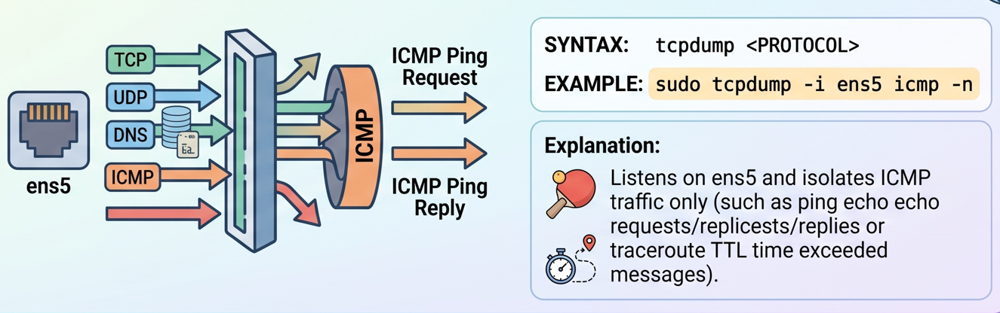
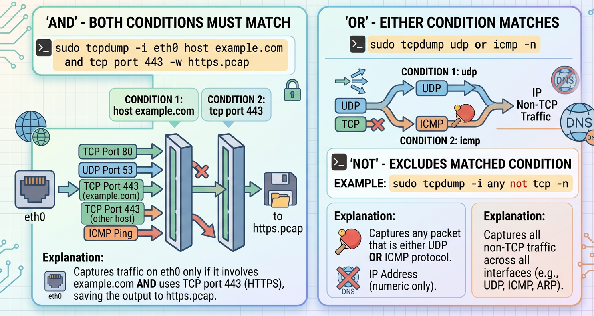
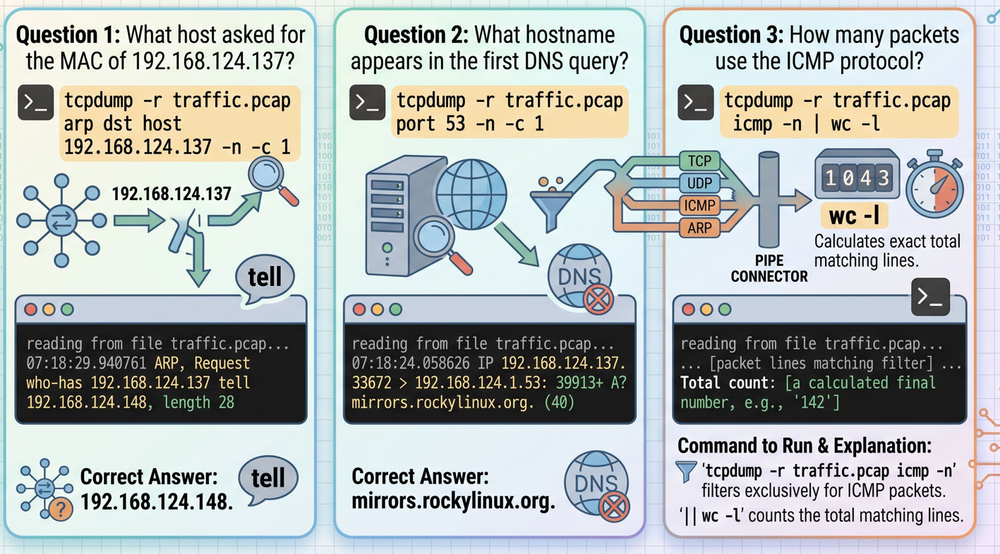
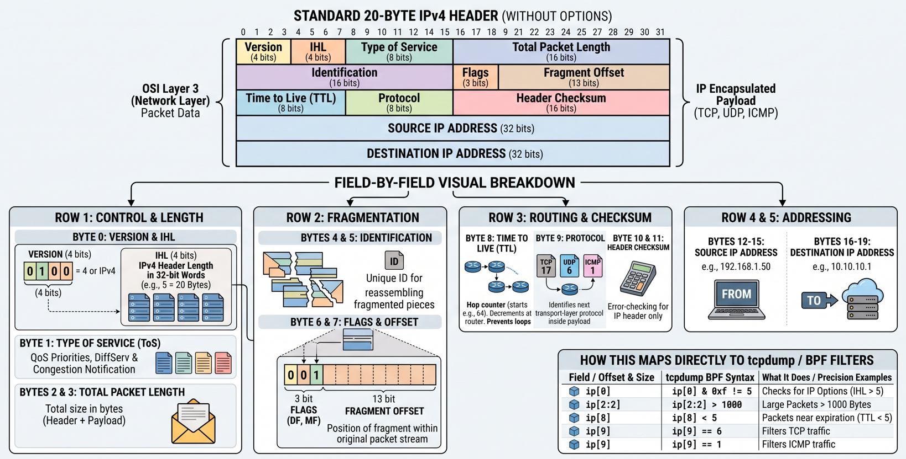
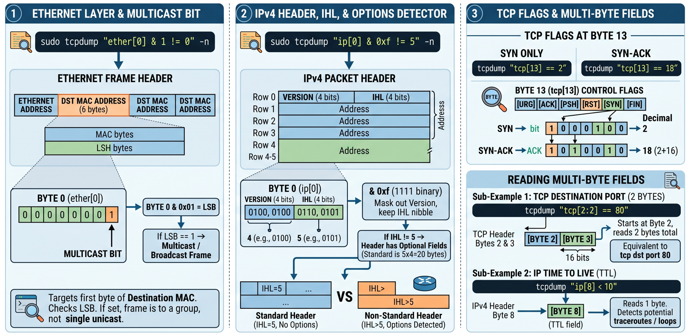

# tcpdump

## How I use tcpdump

tcpdump is a command-line tool for capturing and inspecting network packets. My notes cover live capture, packet filtering, output control, and reading saved PCAP files.

Live capture usually requires elevated privileges because it accesses network interfaces. Reading an existing capture file does not normally require root privileges.

The screenshots below are the actual files uploaded from my tcpdump Notion notes. They show command examples and filter syntax.

## 1. Basic commands

I use the interface list to identify available capture interfaces. I can capture a small sample for a quick check or write traffic to a PCAP file for later review.

```bash
sudo tcpdump -D
sudo tcpdump -i any -v -c 1
sudo tcpdump -i any -w capture.pcap
```



## 2. Host-based filtering

Host filters help me focus on traffic associated with a specific IP address or hostname.



## 3. Port-based filtering

Port filters narrow the capture to traffic using a specific transport-layer port.



## 4. Protocol-based filtering

Protocol filters help isolate traffic such as IP, IPv6, TCP, UDP, ICMP, and ARP.



## 5. Logical operators

I can combine filter expressions with logical operators to narrow down the traffic I want to capture or review.



## 6. Offline inspection and packet counting

I can read an existing capture file and pipe filtered output into `wc` to count matching lines.

```bash
tcpdump -r traffic.pcap src host 192.168.124.1 -n | wc -l
```



## 7. Packet length and bitwise filters

tcpdump supports packet length filters and bitwise operations for checking individual bits in protocol headers.



## 8. Berkeley Packet Filter byte offsets

BPF syntax can inspect specific byte offsets in packet headers. My notes describe the general format as:

```text
proto[offset:size]
```



## Live capture and offline review

I separate the capture stage from the review stage:

1. Identify the interface that should be monitored.
2. Choose a capture filter that matches the traffic needed.
3. Save the capture to a PCAP file.
4. Read the file back with tcpdump.
5. Apply narrower filters to inspect relevant traffic.

The quality of the review depends on what was captured. A filter that is too narrow can exclude traffic that may later be useful.

## Source

[My Notion notes: tcpdump](https://app.notion.com/p/3c2f055fceba8086af04d794e8b83e17)
