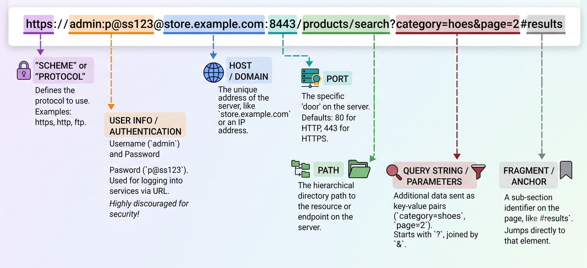
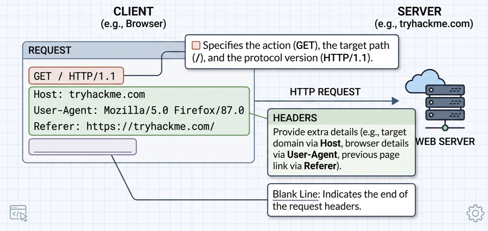
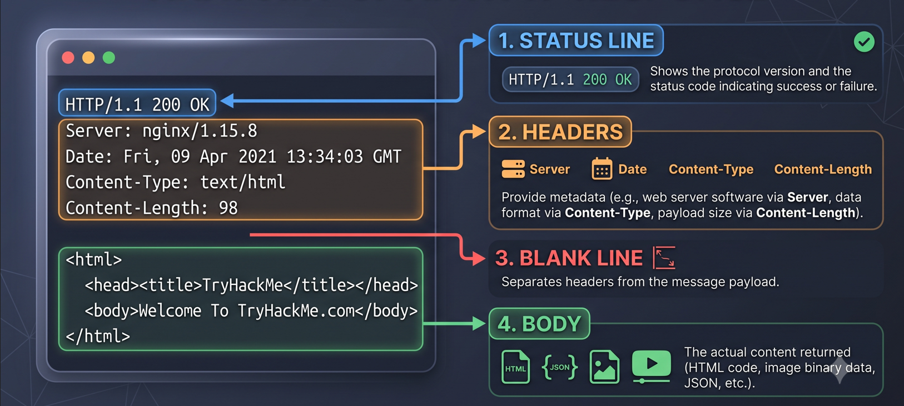
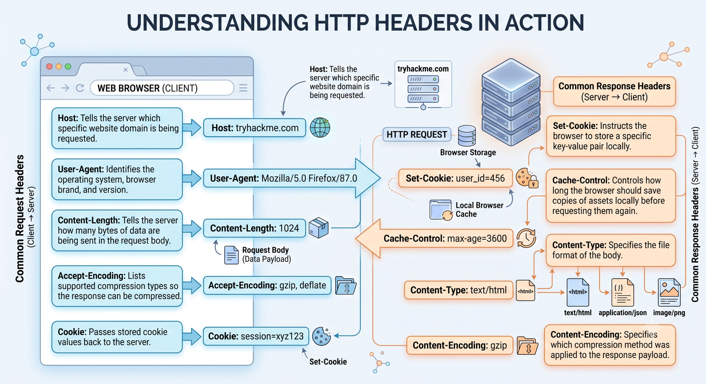
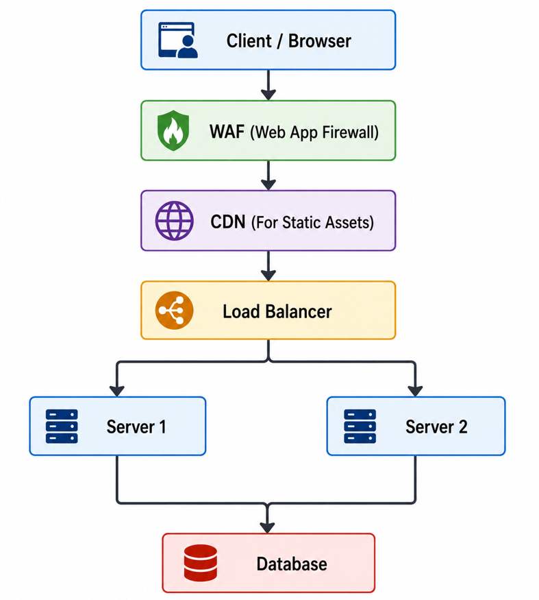

# DNS and HTTP Fundamentals

I use this page to keep the DNS and HTTP reference material from my notes together. These topics help me understand how a client locates a service, sends a web request, and receives a response.

The screenshots below are the actual files I uploaded from my Notion notes. They are reference material. They are not packet captures or evidence from a separate incident investigation.

## DNS domain structure

DNS maps domain names to IP addresses. Understanding the parts of a domain helps me read query names and identify which part is the subdomain, registered domain, or top-level domain.

## URL structure

A URL identifies the resource a client wants to access and includes the information needed to locate it.

## HTTP request and response

An HTTP request is sent by a client to ask a server for a resource or action. The server returns an HTTP response with a status and any requested content.

## HTTP status codes

The response status code helps me understand whether a request succeeded, was redirected, failed because of the request, or failed on the server.

## HTTP headers and cookies

Headers carry request and response metadata. Cookies can be used to maintain session state between requests.

## How I use these notes

I use these concepts when reviewing DNS and HTTP activity in logs or packet captures. I check the domain or host, request method, response status, headers, and available payload. I keep metadata separate from content because a log entry may show that a request occurred without containing the full transferred data.

## Source

[My Notion notes: DNS and HTTP](https://app.notion.com/p/3b4f055fceba80ac8ca5d0c7ab247bcc)
