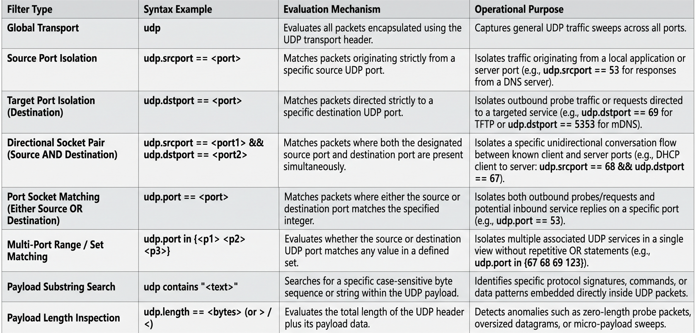
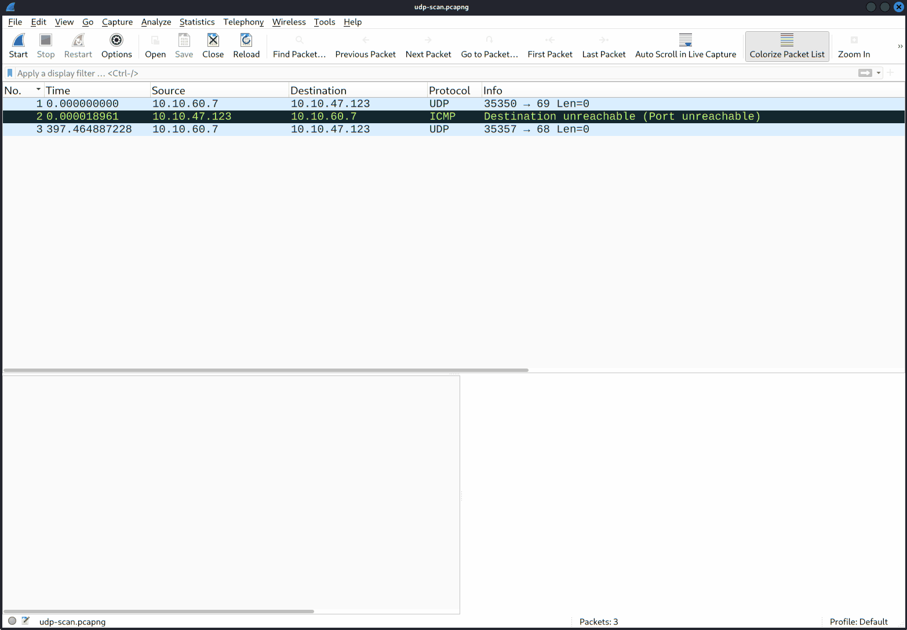
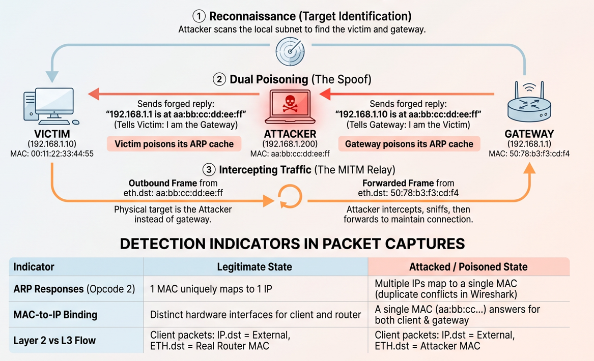
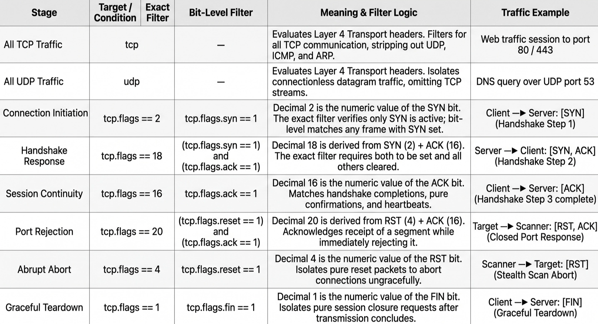
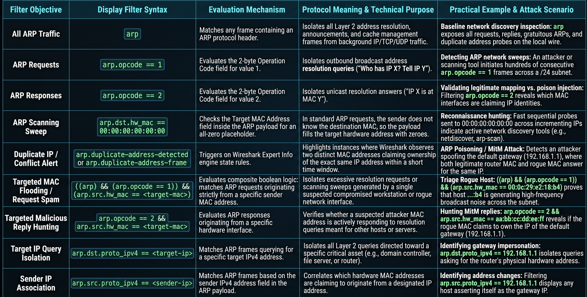

# Wireshark Network Traffic Analysis: TCP, UDP, ICMP and ARP

## What I cover

My Wireshark traffic analysis notes explain TCP control flags, display filter syntax, the TCP three-way handshake, and packet patterns associated with TCP connection scans.

## TCP flags

The flags covered in my notes include:

| Flag | Decimal weight | Purpose in my notes |
| --- | ---: | --- |
| FIN | 1 | Starts graceful connection termination |
| SYN | 2 | Coordinates sequence numbers to start a connection |
| RST | 4 | Resets or rejects a connection |
| PSH | 8 | Pushes data toward the application |
| ACK | 16 | Acknowledges received data or handshake traffic |
| URG | 32 | Marks urgent data |

## Exact-match and bit-level filters

An exact-match filter checks the aggregate flag value.

Examples:

```text
tcp.flags == 2
tcp.flags == 18
tcp.flags == 20
```

These values represent SYN, SYN plus ACK, and RST plus ACK in the examples from my notes.

A bit-level filter checks whether a particular flag is set, even when other flags are also present.

```text
tcp.flags.syn == 1
```

This matches packets where the SYN bit is set, including both SYN and SYN-ACK packets.

## TCP connection scan examples

My notes compare two scan patterns:

- **TCP Connect Scan:** Completes the three-way handshake before closing the connection.
- **TCP SYN Stealth Scan:** Sends a SYN and, when the target responds with SYN-ACK, terminates the attempt with a reset rather than completing the handshake.

The notes include these example filters:

```text
tcp.flags.syn == 1 and tcp.flags.ack == 0 and tcp.window_size > 1024
```

```text
tcp.flags.syn == 1 and tcp.flags.ack == 0 and tcp.window_size <= 1024
```

These are the signatures described in my notes. I treat them as filters for reviewing traffic, not as a standalone verdict that a scan is malicious.

## How I would review a capture

1. Start with the TCP traffic.
2. Isolate initial SYN packets.
3. Review the source and destination addresses and ports.
4. Follow the packet sequence to see whether the handshake completed.
5. Review resets and connection teardown.
6. Compare repeated connection attempts and their targets.

## Source

[My Notion notes: Wireshark Traffic Analysis](https://app.notion.com/p/3edf055fceba80979359e93edc7bb146)


## UDP, ICMP, and ARP traffic analysis

My Wireshark traffic analysis notes also cover UDP probing, ICMP error responses, and ARP spoofing indicators. I keep these topics here because they use the same packet inspection workflow as the TCP examples above.

### UDP analysis

I review UDP traffic by looking at source and destination ports, packet direction, and whether a response is present. A lack of response alone does not confirm that a port is open or that a host is compromised.



### ICMP error responses

ICMP provides error and diagnostic information. For example, a UDP packet sent to a closed port can result in an ICMP Destination Unreachable response with a Port Unreachable code.



### ARP spoofing indicators

ARP maps local network IP addresses to MAC addresses. I look for conflicting claims where different MAC addresses appear to claim the same IP address, then compare the timing and surrounding traffic before drawing a conclusion.



### TCP scan lifecycle and filters

The TCP scan reference below connects the flag values and filter patterns described earlier with the expected connection sequence.



### Essential display filters



The images are reference material from my Notion notes. They are not evidence from an original packet capture in this repository.
